<!-- readme-standard: 2026-11-02 -->
<div align="center">



# hardhat_example


 **You are here:** drasticstatic lab › DappU coursework › `hardhat_example` · public · `main` is the working branch

</div>

##  TL;DR

1.  **What this is.** A basic Hardhat sample project, kept with four test folders.
2.  **Who it is for.** Anyone getting started with Hardhat.
3.  **Do this first.** Run `npx hardhat help`, then `npx hardhat test`.

### Sample Hardhat Project

This project demonstrates a basic Hardhat use case. It comes with a sample contract, a test for that contract, and a Hardhat Ignition module that deploys that contract.

Try running some of the following tasks:

```shell
npx hardhat help
npx hardhat test
REPORT_GAS=true npx hardhat test
npx hardhat node
npx hardhat ignition deploy ./ignition/modules/Lock.js
```
## hardhat_example

# Project Structure

- `/1`: Test from MBP
- `/2`: Test again from iMac
- `/3`: Test one last time from MBP :-)
- `/4`: Test to make ensure VScode UI source control working again after ggshield pre-commit "command not found"

##  Suggest a change

Noticed something? Open an [issue](../../issues) or a pull request against `main`; Christopher reads them and a person with the role merges. Not on GitHub? Reach Christopher through [his contact page](https://drasticstatic.github.io/resume/pages/contact.html).

<sub>The front door follows the living [README standard](https://github.com/drasticstatic/my-template/blob/main/README-STANDARD.md). Copy it, improve it.</sub>
